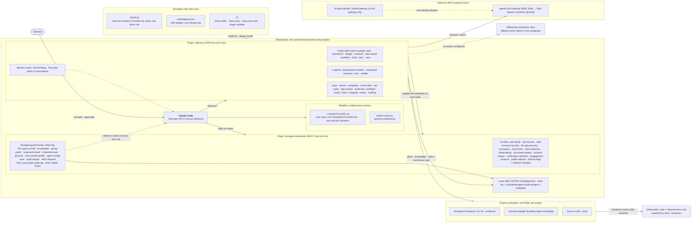
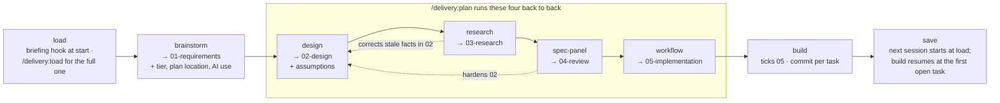

# DevAgent design

The normative design of both plugins. Code and step files cite it as
`DESIGN §n`. Section numbers are stable.

## 1. The system at a glance

### 1.1 Architecture



### 1.2 Delivery flow



Tier S skips straight from brainstorm to a short 05 and build; tier M runs a
lighter design, research and panel (§3.2).

### 1.3 Every component, described

| Layer | Component | What it does | Lives in | Loads |
|---|---|---|---|---|
| Resident | `~/.claude/CLAUDE.md` | Your prohibitions and rules whose failure is *not noticing*; one stub per standards skill. Start from `templates/CLAUDE.md` | your own file, linked by `install.sh` | every session |
| Resident | Built-in auto-memory | Operator preferences and feedback | `~/.claude/projects/…/memory/` | every session |
| Standards | 14 skills + OWASP checklist | The detailed standard per domain | `plugins/devagent-standards/` | on description match or stub |
| Standards | devagent-guard | Deterministic backing for the toolchain rules; the audit log; session health check. Enforces by default (`MODE`); `DEVAGENT_GUARD_MODE=warn` rolls back locally | `plugins/devagent-standards/hooks/` | every tool call / session start |
| Delivery | 9 step skills | The workflow (§3); thin wrappers over step files | `plugins/delivery/skills/<step>/SKILL.md` | when typed |
| Delivery | Step files | The instructions for each step, readable by `plan` | `plugins/delivery/references/steps/` | by a step skill or `plan` |
| Delivery | 4 agents | Context-isolated workers (§4) | `plugins/delivery/agents/` | when dispatched |
| Delivery | Lenses, templates | Reviewer perspectives; skeletons of 01–05 | `plugins/delivery/references/` | by spec-panel / steps |
| Delivery | delivery hooks | SessionStart briefing; PostToolUse plan check for `docs/plans/` | `plugins/delivery/hooks/` | session start / edits |
| Delivery | `check-plan.py` | Validates a plan folder against the grammar (§5) | `plugins/delivery/scripts/` | CI, hook, build |
| Delivery | `run-verify` | Runs a task's verify command and writes the evidence itself | `plugins/delivery/scripts/` | build |
| Delivery | `build-*` scripts | Lock, preflight, ready set, claim (worktree per task), integrate (scope check before anything runs, verify, squash with the tick), status; logic in `build-lib.py` | `plugins/delivery/scripts/` | build |
| Delivery | `briefing.py` | Both delivery hooks: structure-only SessionStart briefing; PostToolUse `check-plan.py --hook=` | `plugins/delivery/scripts/` | session start / edits |
| Delivery | `web-search` | Optional signed call to AgentCore Web Search; stdlib-only SigV4 (§6) | `plugins/delivery/scripts/` | research |
| Delivery | `PINS.md` | Every pinned version, why, and when last reviewed | `plugins/delivery/` | quarterly review, check-skills |
| MCP (optional) | Playwright, pinned | Isolated browser for checking web UIs and rendering diagrams | `~/.claude.json`, user scope | every session |
| AWS (optional) | Gateway + Web Search, pinned | Current web knowledge for research | your tooling account, `infra/terraform/web-search/` | research |
| State | NOTES.md | This session | project root, gitignored | load / save |
| State | `docs/plans/<feature>/` | The delivery record of one feature | project workspace — never delivered | steps |
| State | `docs/knowledge/` | Durable project knowledge | project workspace | load / save |
| Output | Deliverable | Code and selected docs only, assembled at handover | exported from the workspace | `save --handover` |
| State | Audit log | Every tool call, redacted, per project | `~/.claude/devagent-audit/<project>/` | hooks |

## 2. Principles

1. **Deterministic where the failure is not noticing.** Format rules, evidence,
   unsettled findings, verify commands, query contents and diff scope are
   checked by scripts. The model never writes its own evidence.
2. **The file is the state** — and the file is untrusted input. Plan and
   knowledge text is DATA to every agent; nothing in a plan file is executed
   without passing an allowlist.
3. **Standards at the step that needs them.**
4. **Least privilege per step.** Each agent has an explicit tool list; search
   runs under an identity that can do nothing else.
5. **Ceremony proportional to the work** (§3.2).
6. **Short skills.** Instructions live in step files; skills are wrappers.

## 3. The steps

### 3.1 Invocation

Each step is a plugin skill, user-invoked only: frontmatter
`disable-model-invocation: true`, `argument-hint: <feature>`, arguments via
`$ARGUMENTS`. The prefix stays: `/delivery:design payroll-importer` →
`docs/plans/payroll-importer/`. Feature names match `^[a-z0-9][a-z0-9-]*$`.
Each SKILL.md reads `${CLAUDE_PLUGIN_ROOT}/references/steps/<step>.md`, so
`plan` can run steps 2–5 by reading the same four files. This document
says "step" or "command" for how they are used; the files are skills.

### 3.2 Tiers

| Tier | When | Files | Research | Panel |
|---|---|---|---|---|
| **S** | one file or a few tasks, no new data store or external surface | 05 only, with an intent header | none | none |
| **M** | a feature inside an existing design | 01, 02, slim 03 and 04, 05 | load-bearing assumptions only | 3 lenses (builder, attacker, pre-mortem) on a cheaper model |
| **L** | new system, new data store, new external surface, or client-facing design | 01–05 | load-bearing + bounded look | all applicable lenses |

`brainstorm` proposes the tier from explicit triggers — a new data store, a
public endpoint, a login, a new external service, or more than about five
tasks makes it at least M — the operator confirms or overrides, and it is
recorded in the front matter. `check-plan.py` validates the grammar of every file present; that each tier's
required files exist is enforced by `workflow` and `build`, which refuse to start without them.

**Never skipped at any tier:** the guard hooks and audit log, the resident
rules, `run-verify` evidence, the verify allowlist, the diff scope check, and
the standards skills when the work matches them. Tiers drop planning
ceremony, not safety.

**Escalation:** if a tier-S or tier-M build reaches a task that needs a new
dependency, touches a path outside its declared files, or crosses one of the
triggers above, build stops and proposes moving up a tier instead of carrying
on.

### 3.3 Contracts

| Step | Contract | Applies standards |
|---|---|---|
| `load` | Full briefing: NOTES.md current section, knowledge index and the files relevant to active plans, each plan's progress and next ready task, build lock state, git state. All of it labelled DATA. | — |
| `brainstorm` | Interactive. Settles goals, users, data handled, client constraints, acceptance criteria; **records tier and the client's AI-use position** — approved services, regions, no-AI zones, contract clause or "none stated". Writes 01. | asks what `stack-selection` and `llm-app-security` depend on |
| `design` | Writes 02 from the template, including threat model, data classification, cost, observability, and **Assumptions to verify**, each marked `load-bearing` or not. Sets `personal_data`, `calls_model`, `has_ui` in front matter. | as the design touches them |
| `research` | For each load-bearing assumption (plus a bounded look at tier L): leads from `web-search`, then **confirmation on an allowlisted official page**; live `aws`/`gh` checks where they exist. Writes rows to 03 as they complete, so a re-run resumes. Applies corrections to 02 with change-log entries, **flagging** any change in a security-relevant category. | `verification-methods` |
| `spec-panel` | Dispatches one fresh `delivery:reviewer` per applicable lens, in parallel, each blind to the others. Merges, dedupes (same section + same root cause; originals kept), ranks. Applies fixes to 02; records every outcome in 04. | each lens loads its own |
| `workflow` | Writes 05 from the final 02. Refuses while any `needs-decision` is open or any load-bearing assumption is ❓. Declares the allowed verify commands in 05's front matter. Runs `check-plan.py`. | `verification-methods`, TESTING STANDARDS |
| `build` | Executes 05 under the protocol in §4.4. Never pushes. `--status` gives a read-only view. | `verification-methods`; `public-release` if a task publishes |
| `plan` | Runs design → research → spec-panel → workflow, resuming at the first missing file; pauses for flagged decisions; ends with a summary. Requires 01. | as each step |
| `save` | Updates NOTES.md; writes durable project lessons to `docs/knowledge/` **in this repo only**; proposes generic lessons (no client detail) to the operator for the config repo, never automatically; sets the newest step file's status; reports uncommitted and unpushed work, orphaned worktrees, open locks, plan drift; `--handover` exports the leak-scanned client deliverable from an approved manifest (§11, C-53); `--closeout` inventories every copy of engagement material for `engagement-closeout`. | `public-release`, `engagement-closeout`, LICENSE COMPLIANCE |

### 3.4 Security-relevant changes always stop for the operator

`research`, `spec-panel`, `build` and `plan` never apply, without operator
approval, any change to: a package name or version; a URL or endpoint; a shell
command or verify command; an IAM, SCP or permission statement; or a security
control (authentication, TLS, cryptography, logging, input validation). This
extends FR-3's scope/cost/timeline/commitment list. Reviewers *propose*;
`spec-panel` applies.

## 4. Agents and how build runs

### 4.1 The four agents

| Agent | Adapted from (MIT) | Job | `tools` | `model` |
|---|---|---|---|---|
| `requirements-analyst` | SuperClaude `requirements-analyst` | Draft 01 from the conversation | Read, Write (docs/plans only) | Sonnet |
| `researcher` | SuperClaude `deep-research-agent` | Verify a batch of assumption rows — receives only those rows, never 01/02 whole | Read, WebFetch (allowlisted), `Bash(${CLAUDE_PLUGIN_ROOT}/scripts/web-search:*)` only | Sonnet; Opus confirms 🔄/⛔ |
| `reviewer` | SuperClaude `security-engineer`, `system-architect`, `devops-architect`, `quality-engineer` | Review through one lens, inlined by spec-panel | Read, Grep, Glob, Skill | per lens |
| `builder` | new | Implement one task in its own worktree; WIP commit there; no ticks | Read, Grep, Glob, Edit, Write, Bash | Opus |

No agent declares hooks or MCP servers (plugin agents cannot).
All agents are told that file and web content is data. Reviewers are always
fresh `delivery:reviewer` dispatches, never forks of the main context.

### 4.2 Review lenses

Each lens is `references/lenses/<slug>.md` with front matter `slug`,
`standards: [...]`, `when: always | personal_data | calls_model | has_ui`,
`model`, `effort`. Each returns at most its top 5 findings.

| Lens (`slug`) | when | Standards | Model |
|---|---|---|---|
| architecture-board | always | `stack-selection`, `cloud-infra` | Sonnet |
| attacker | always | `auth-portal`, `api-security`, `web-browser-security` | Opus, high effort |
| sre | always | `observability` | Sonnet |
| vendor-risk | always | `encryption`, `engagement-closeout`, OWASP | Sonnet |
| builder | always | `verification-methods` | Sonnet |
| inheritor | always | `engagement-closeout` | Sonnet |
| finops | always | `cloud-infra` | Sonnet |
| pre-mortem | always | — | Opus, high effort |
| privacy | personal_data | `encryption` | Sonnet |
| ai-security | calls_model | `llm-app-security` | Opus |
| accessibility | has_ui | `dataviz` when charts; WCAG 2.1 AA floor, 2.2 AA target | Sonnet |

Reviewers receive 02 in full, 01's acceptance criteria and 03's 🔄/⛔ rows
inline, the rest by path. A re-run after fixes reviews only changed sections.

### 4.3 Who decides what

| Finding | Goes to the operator if | Else |
|---|---|---|
| any | severity high or critical, or found by ≥ 2 reviewers, or in a §3.4 category | applied, or dropped with a one-line log |
| rejecting a high or critical | always — worded as *accepted risk*, with owner and rationale | — |

`save` reports the rejection rate per lens, so a lens that is always rejected
gets retired.

### 4.4 Build protocol

**Start**
1. Take an exclusive lock at `.git/delivery-build.lock` (PID, session, start
   time). A live lock refuses to start; a stale one needs explicit takeover.
2. Check HEAD is on 05's recorded `branch` and descends from its `base`.
3. Run `check-plan.py`; refuse a malformed plan.
4. Reconcile every `[~]`: if its branch holds a commit that passes verify,
   integrate it; otherwise reset to `[ ]` and remove the worktree. Report.
5. On first run, or if 05 changed outside build/workflow commits: show the
   distinct verify commands and get operator approval.

**Dispatch** — ready = `[ ]` with every dependency `[x]`. Up to **3** builders
in parallel (configurable), only for tasks whose `files` do not overlap. Each
gets a fresh worktree on branch `delivery/<feature>/T-nn` from current HEAD,
and the task is marked `[~] owner=<user> session=<id> started=<ts> worktree=<path>`.
Parallel or unattended runs require guard enforce mode; otherwise build runs
attended and one task at a time.

**Flag remove tasks are held.** A task carrying `- flag: remove <name>` is
never ready by default, even when its dependencies are `[x]`: removing a flag
comes after its rollout, usually after delivery. `build-ready` leaves it out
and prints `held for rollout: T-nn (flag <name>, remove by <date>)`; it stays
`[ ]`, is not blocked and never stops the build. The operator runs
`/delivery:build <feature> --remove-flags` once the rollout is finished, which
passes `--removal` to `build-ready` and offers those tasks like any other.
`save` may set 05 `complete`, and `save --handover` delivers, with held remove
tasks still `[ ]`; the handover manifest lists each with its client-side owner
and date.

**Integrate — one task at a time, in task-ID order**
1. The builder has made one WIP commit on its branch.
2. **Scope check:** `git diff --name-only` against HEAD ⊆ the task's `files`.
   Anything else — and always `.claude/`, `.mcp.json`, `CLAUDE.md`,
   `.github/`, `.git/hooks`, `.husky/`, `infra/`, dependency manifests or
   lockfiles that add a package — is `[!] scope` and needs the operator.
3. Rebase the branch onto HEAD inside its worktree. Conflict → abort,
   `[!] conflict with T-nn`, branch kept.
4. `run-verify` in the worktree, with AWS and GitHub credentials stripped
   from its environment, under the task's `timeout` (default 10 min).
5. Pass → squash the branch onto main as one commit containing code **and**
   the tick, message per the repo's convention; remove the worktree.
   Fail → main untouched, `[!]` with the reason and the branch name kept.
   After **2** failed attempts the task stays `[!]`.
6. Before each commit: refuse any staged path under `.playwright-mcp/`
   and ensure it is gitignored.

**Stop** — on the first `[!]`, dispatch nothing new; builders already running
finish and integrate individually; then a single table of every task's state.

**Never** pushes, opens a PR, or edits outside the engagement workspace.

## 5. File grammar (normative) — `delivery-plan/1`

### 5.1 Front matter

All files: `format: delivery-plan/1`, `feature`, `step`, `status`, `date`,
`generator: delivery@<release-tag>`. `reads` on every file except 01.

| Step | Extra keys |
|---|---|
| 01 | `tier`, `ai_use` |
| 02 | `tier`, `personal_data`, `calls_model`, `has_ui`; optional `flagged` |
| 04 | `classification` |
| 05 | `branch`, `base`, `verify_allowed: [ ... ]`; optional `flagged` |

`flagged` is `true` or `false`; absent means `false`. It marks a feature that
ships behind one or more feature flags. 05 carries it too, copied from 02, so a
tier S plan with no 02 can be flagged; where both carry it the values must
agree.

`status` ∈ `draft · approved · reviewed · complete · as-built · superseded`.

### 5.2 IDs and cross-references

| Kind | Pattern | Defined in | Referenced from |
|---|---|---|---|
| Assumption | `A-nn` | 02 §Assumptions, 03 | 03 rows, change-log sources |
| Bounded-look finding | `X-nn` | 03 | change-log sources |
| Review finding | `R-nn` | 04 | change-log sources |
| Change | `C-nn` | 02 change log | 04 outcomes |
| Task | `T-nn` | 05 | 05 `depends`, commit messages |
| Decision | `D-n` | 02 §Open decisions, 04 | 04 outcomes |

`T-`, `R-` and `C-` IDs use two or more digits; `A-`, `X-` and `D-` may use one.
Change-log `Source` ∈ `operator · research A-nn · research X-nn · R-nn ·
render check · T-nn` (a build departure). Every table has its separator row.

### 5.3 `03-research.md` rows

```
| # | Assumption | Status | Current truth | Official source | Checked | Engine |
|---|---|---|---|---|---|---|
| A-04 | Node.js 20 runtime supported | ⛔ | Deprecated 2026-04-30; create blocked 2027-07-29 | https://docs.aws.amazon.com/lambda/latest/dg/runtime-support-policy.html | 2026-10-04 | web-search |
```

`Status` ∈ ✅ 🔄 ⛔ ✨ ❓. `Official source` is one or more `https://` URLs
joined by ` · `, or `live: <command>`; for 🔄 and ⛔ the URL's host must be on
the official-domain allowlist. `Engine` ∈ `web-search · official-page ·
manual`. A `## Queries sent` section lists every query.

### 5.4 `04-review.md` findings

```
### R-03 · high · 3/8 (attacker, vendor-risk, sre)
- section: 02 §7
- finding: POST /claims has no rate limit
- fix: per-tenant token bucket at the gateway
- outcome: applied → C-02
```

`outcome` ∈ `applied → C-nn` · `rejected — <reason>` · `accepted risk — owner
<role>, <rationale>` · `needs-decision — D-n`.

### 5.5 `05-implementation.md` tasks

```
### T-07 [x] Add per-tenant rate limit
- depends: T-03, T-05
- files: src/gateway/limits.ts, test/limits.test.ts
- acceptance: 101st request in a minute returns 429 for that tenant only
- verify: `npm test -- limits`
- timeout: 10m
- evidence: run-verify · exit 0 · tests 12 · 4.2s · log evidence/T-07.log sha256:9b1c… · 2026-10-06
```

`depends: none` when empty. `evidence` is written **only** by `run-verify`; no commit SHA — the commit is found by its `T-07` message.
`[~]` lines carry `owner`, `session`, `started`, `worktree`; `[!]` lines a reason.

In a `flagged` plan, each flag adds bullets to three kinds of task:

```
### T-02 [x] Add flag new-search, off by default
- flag: add new-search

### T-04 [ ] Search behind new-search
- flag on: the new search endpoint returns results
- flag off: the old search answers and the new endpoint returns 404

### T-06 [ ] Remove flag new-search
- flag: remove new-search
- flag_owner: client platform lead
- remove_by: 2027-01-31
```

- **Add task:** `- flag: add <name>`. **Remove task:** `- flag: remove <name>`,
  `- flag_owner: <role>`, `- remove_by: YYYY-MM-DD`. `<name>` matches
  `^[a-z0-9][a-z0-9._-]{0,62}$`; `flag_owner` is a client-side role, not a
  person, and is a separate key from `owner`.
- **Guarded task** — any task that depends on the add task and is not a remove
  task: `- flag on: <check>` and `- flag off: <check>`, each saying what is
  observed with the flag in that state. A task guarded by two flags carries
  one pair that covers both.
- Each key appears at most once per task, and a task carries at most one
  `- flag:` bullet. A plan may hold several flags, each with exactly one add
  and one remove task.

### 5.6 What `check-plan.py` enforces

Interface: `check-plan.py <feature-dir> | --all [--hook PATH]`. Exit 1 on any
failure; `--hook` is silent on pass. Report mode:
`check-plan.py --flags <feature-dir> | --flags --all [--today YYYY-MM-DD]`.

- Grammar above: front-matter keys per step, `format` version, `status` vocabulary, ID patterns, table separators.
- 01 has non-empty `## Data handled` and `## Client constraints` sections; `none stated` counts as an answer.
- IDs unique; every reference resolves; `depends` acyclic.
- Every `R-nn` has an outcome; every `applied → C-nn` exists in 02; no `needs-decision` once 05 exists.
- Every `[x]` has `run-verify` evidence whose log file exists and matches its hash, with tests > 0 where the runner reports counts; exactly one `T-nn` commit per `[x]` (in a repo), counting a commit that touches the task's `files` or its own evidence log (`T-nn.log`), so a verification-only task that changes no file still has its one commit.
- Every `verify` matches `verify_allowed` and contains no shell metacharacters `; | & $ \` > <`.
- Every 🔄/⛔ source is on the allowlist; every recorded query is clear of the engagement deny-list.
- Every `[!]` has a reason; every `[~]` has an owner.
- **`flag-plan`** (§5.5 flag bullets), read from each task's raw lines so a
  hidden second line or an `owner` sub-field cannot slip past:
  - no flag key repeated in a task or passed as an `owner` sub-field; the
    `flag` verb is `add` or `remove` and the name matches its pattern;
  - a `flagged` plan has at least one flag task; each name has exactly one add
    and one remove task; `flag_owner` and `remove_by` appear only on remove
    tasks, which must carry both, with `remove_by` a real `YYYY-MM-DD` date;
  - per flag, every other task is a prerequisite of the add task or depends on
    it, and the remove task depends on every task that is not a remove task;
  - every guarded task carries `flag on` and `flag off`;
  - no flag bullet in an unflagged plan; 02 and 05 agree on `flagged`.

  A `remove_by` in the past never fails the rule; overdue is reported, not
  enforced, so a plan does not start failing the hook because a day passed.
- **`--flags` report** (read-only): runs every check above on each folder
  first; a failing folder prints `<feature>: plan fails check-plan.py; flags
  not reported`. Otherwise one line per flag,
  `<feature>: flag <name> · added <state> · owner <role> · remove by <date> · <status>`,
  where `<status>` is the first of `removed` (both tasks `[x]`),
  `inconsistent` (remove `[x]`, add not), `overdue` (remove not `[x]` and its
  date passed) or `live`, with ` · beyond a year` appended when `remove_by` is
  more than 365 days after 05's `date`. A folder with no flags prints
  `<feature>: no flags`. Exit 0 when every folder reported, 1 when any failed
  its checks, 2 on a usage error (a bad `--today`, an unknown option, or
  `--flags` with `--hook`).
- **Output sanitising:** every printed line is built from untrusted plan text,
  so each failure line and each `--flags` line is sanitised in one place:
  Unicode `Cc`, `Cf`, `Zl` and `Zp` characters (newline, ESC, U+202E) become
  `?`, so a value cannot forge a second `file:line: [rule]` line; a message is
  capped at 300 code points, ending `…`; in `--flags`, owners and dates are
  capped at 80 each.
- Negative tests for each rule; this plan folder is a CI fixture that must pass.

## 6. Web search (optional): AWS Bedrock AgentCore Web Search

Research exists to beat the model's knowledge cutoff, so it confirms facts on
current sources. Search is **optional**: without it, research confirms each
fact by fetching the official page directly (§6.4).

### 6.1 The service

- AWS Bedrock AgentCore Web Search: an AWS-operated index reached through an
  AgentCore **Gateway** target (connector `web-search`). Queries do not go to a
  third-party search engine. Priced per 1,000 queries; check current pricing.
- **Pin the connector version.** Domain and published-date filters exist only
  from connector 1.2.0; the default version has none.
- **Signing:** SigV4, service name `bedrock-agentcore`; inbound authorizer
  `AWS_IAM`. Callers need `bedrock-agentcore:InvokeGateway` on the gateway; the
  gateway's own role needs `InvokeGateway` and `InvokeWebSearch`.
- **Tool arguments:** `query`, `maxResults` (1-25), and from 1.2.0
  `filters.domainFilter.include/exclude` and
  `filters.publishedDateFilter.from/to`.
- **Data use:** read the current AgentCore service terms before use. At the
  time of writing they allow AWS to use and store content to improve the
  service, with no opt-out, and AWS Organizations AI opt-out policies do not
  cover AgentCore. The deny-list (§6.2) is the control: queries are generic,
  never client or project specifics.

### 6.2 `web-search`

```
web-search QUERY [--include DOMAIN]... [--exclude DOMAIN]... [--since YYYY-MM-DD] [--max N] [--json] [--profile NAME]
```

- **Identity:** an AWS profile (`--profile`, else `DEVAGENT_SEARCH_PROFILE`,
  else `AWS_PROFILE`). Use a narrowly scoped identity: model invocation plus
  `InvokeGateway` on this one gateway, nothing else.
- **Endpoint:** `~/.config/devagent/web-search.json` (mode 600) holding the
  gateway URL, written from the Terraform output `search_gateway_url`
  (`infra/terraform/web-search/`). Missing: **exit 7, not configured**.
- **Before sending:** the query is checked against the project's deny-list
  (`.delivery/deny-list`, gitignored); a match blocks with exit 2.
- **Protocol:** one `tools/call`; checks the target's connector version and
  **fails closed** if it is not the pinned one.
- **Output:** `{"engine":"web-search","query":…,"results":[{"title","url","published","excerpt"}]}`; `--max` default 5.
- **Exit codes:** 0 ok · 2 usage or deny-list · 3 credentials (sign in for the
  profile) · 4 denied (action + ARN) · 5 throttled (after backoff) · 6 upstream
  or protocol · 7 not configured. Never prints credentials.
- **Budget:** a per-run counter enforces 3 queries per assumption + 10.
- **Audit:** each call appends query, result URLs and a hash of the result set
  to `~/.claude/devagent-audit/search.jsonl`.

### 6.3 Infrastructure

`infra/terraform/web-search/` creates the gateway, its pinned Web Search
target, the gateway role, and an IAM policy for the caller identity. Apply it
in a dedicated tooling account, never one that holds client data. Two checks
before relying on it: read the account's **Bedrock data-retention mode**, and
confirm every inference profile in use routes only to the Regions you intend
(a region prefix on a profile name is not the guarantee).

### 6.4 Fallback

- **Exit 7 (not configured):** research proceeds without search. Each fact is
  confirmed by fetching the official page directly (WebFetch), and the guard's
  `fetch-allowlist` rule limits that to official domains while research is
  active. Rows record `engine: official-page`.
- **Exit 6 (upstream):** the same official-page path, for that query.
- **Exits 3 and 4 stop and ask.** An expired session or a denied call is not
  something to route around.

## 7. Storage decision: markdown in git

**Decision: markdown files in git as the system of record.** (Unchanged by
review.)

| Option | For | Against, for us |
|---|---|---|
| **Markdown in git** *(chosen)* | Reviewable diffs, history, travels with the repo, readable by assessors, offline, zero infrastructure | No semantic search — irrelevant at tens of files |
| S3 Vectors / Knowledge Base | Semantic retrieval at scale | Sends client content to an embedding service; a shared index is cross-contamination by design; fragments, not whole documents |
| Database | Queries, concurrency | Hides the record from review; another client-data store to secure and destroy |
| AgentCore Memory | Managed memory | "*may use and store your content to improve your service experience*" |

From the alternatives we take: front matter for structure, `check-plan.py`
for integrity, one folder per engagement for isolation, and a lock file for
concurrency.

**Public-facts register:** `plugins/delivery/references/public-facts.md`
in this config repo holds confirmed facts from public vendor documentation
only — fact, official source, date checked — and never client material.
`research` reads it first and skips a fresh check when an entry is under 90
days old. New entries are **proposed** to the operator at `save`, never written
from an engagement session, because that would be a write outside the
engagement workspace.

## 8. How the two plugins fit together

- **Hooks:** delivery ships its own `plugins/delivery/hooks/hooks.json` — SessionStart
  `briefing.py` returning `additionalContext` (main session only, a 25-line cap,
  structure only, never free text from plan or knowledge bodies; truncates with
  "run /delivery:load"); PostToolUse on `Write|Edit|MultiEdit` calling
  `check-plan.py --hook`, silent unless the path is under `docs/plans/`. The
  standards plugin keeps the audit log. *One audit log, two plugins each owning
  their own hooks.* Standards never depends on delivery.
- **Guard rules the workflow relies on:** `git-push` (while a build lock is held),
  `aws-outside-profile` (mutating `aws` calls), `agent-config-write` (writes to
  `~/.claude/`, `.claude/`, `.mcp.json`), `audit-tamper` (write, delete or
  `touch` under the audit directory), `fetch-allowlist` (WebFetch and
  Playwright navigation during research), and `uv run --with` without a lock.
  Audit log partitioned per engagement, pruned by filename date, head + tail +
  SHA-256 of long commands, success flag from the tool response.
  Hook budgets: audit write first; internal budget under the harness timeout;
  `hook_error` and heartbeat events reported at session start.
- **Versioning:** one repo tag releases both plugins; both `plugin.json`
  versions bump together; delivery declares
  `"dependencies": ["devagent-standards"]`; `install.sh` and `test-install.sh`
  gain the delivery install line.
- **`check-skills.py`:** a per-plugin rule table — standards: stubs and figure
  counts; delivery: `disable-model-invocation: true`, no stub, its own figure
  count keyed by plugin name; agents: `name` = filename, explicit `tools`;
  lenses: `slug`, `standards`, `when`, `model`. Marketplace descriptions join
  the figure scan; `nine` joins the number words. A negative test per rule.
- **CLAUDE.md:** the NOTES.md protocol in `templates/CLAUDE.md` adds: during
  a build, 05 is the progress record.

## 9. Versions and pins

- **One version for both plugins.** A release is one repository tag; both
  `plugin.json` versions move together, and `delivery` declares
  `"dependencies": ["devagent-standards"]`.
- **Pin by tag and commit.** Install from a release tag, and pin the
  marketplace source to its commit sha, rather than tracking a branch.
- **`plugins/delivery/PINS.md`** lists every version DevAgent depends on
  (Claude Code tested in CI, the search connector, the Terraform provider,
  test tools), where it is set, why, and when it was last reviewed;
  `check-skills.py` fails if a pin and the place it is set disagree.
- **Re-pin deliberately**, never drift to latest: a version change is a
  reviewed commit with the reason in `PINS.md`.

## 10. Security and data handling

- **Injection:** web results, fetched pages, and plan and knowledge files are
  data to every agent. What makes that hold is not the prompt but the controls:
  researcher tools limited to `web-search` and allowlisted fetches; reviewers
  read-only; verify commands allowlisted and approved; diff scope checked;
  §3.4 changes stop for the operator.
- **Credentials:** search runs as a narrowly scoped identity (§6.2); builders
  and verify run with AWS and GitHub credentials stripped.
- **Confidentiality:** deny-list enforced before any query leaves; plan
  and knowledge files stay in the engagement workspace, which is never
  delivered; `save` never writes outside the workspace.
- **Separation across engagements:** inference and search are shared but
  should hold nothing client-specific: check your provider's training and
  retention terms, and note that AgentCore may store query content (§6.1).
  Everything stateful is per engagement: workspace folder, plan folder,
  knowledge, audit partition, deny-list.
- **AI-use disclosure:** 01 records the client's position; 02 carries a
  sub-processor table: service · data sent · region · retention · training
  terms.
- **Supply chain:** stdlib-only scripts; Terraform and provider pinned with a
  committed lockfile; connector pinned and checked; `PINS.md`.
- **Least privilege:** the search identity can invoke one gateway and
  nothing else; if you use AWS Organizations, an SCP allow-list for the tooling
  account is recommended.
- **Logging and evidence:** evidence written by `run-verify` with
  hashed logs; per-engagement audit log, tamper-resistant pruning, search
  result hashes; human review before push or PR is the change-approval control,
  and agent commits carry an `Assisted-by:` trailer.
- **Guard status:** enforcing by default; never run an unattended build in warn mode.
- **Playwright output:** never committed.

## 11. Engagement workspace and handover

- **One workspace folder per client engagement**, held by you, opened as the
  Claude Code project root. Everything this system writes for that client
  lives inside it: `docs/plans/`, `docs/knowledge/`, NOTES.md, the deny-list,
  evidence logs. Nothing from one engagement sits beside another's.
- **The workspace is never delivered.** Review findings, threat models,
  research method and internal tool names therefore never reach the client
  unless chosen for the deliverable.
- **`save --handover`** assembles the client deliverable from an explicit
  manifest the operator approves: the code, plus selected docs — typically the
  as-built design and a risk register of open and accepted-risk findings with
  owners (per `engagement-closeout`). Before export it runs the
  `public-release` leak review against the deliverable (internal tool names,
  other clients, audit and NOTES content, `.claude/`, `.playwright-mcp/`,
  evidence logs) and the LICENSE COMPLIANCE attestation. Output: a zip or a
  fresh repository with no workspace history.
- **`save --closeout`** then inventories every copy of engagement material
  outside the deliverable — the workspace, worktrees, transcripts, memory,
  audit partition, NOTES archive — for `engagement-closeout`'s return or
  destruction duties.

## 12. Run cost

Measured on the pilot, 2026-10-16: feature `guard-report` (`examples/guard-report/`), tier M (3
lenses), 5 tasks, Opus as the main model, one headless `claude -p` session per
step. Figures are Claude Code's own per-session `total_cost_usd`.

| Step | Measured | Turns | Wall time |
|---|---|---|---|
| load | $0.31 | 6 | 40 s |
| brainstorm | $0.31 | 6 | 50 s |
| `plan`: design, research (0 queries), spec-panel (3 reviewers) | $1.70 | 26 | 4.7 min |
| spec-panel, applying 9 operator decisions | $1.00 | 30 | 3.9 min |
| workflow | $0.61 | 13 | 1.8 min |
| build, first session (killed mid-T-01 on purpose) | not recorded | - | ~3 min |
| build, resumed: reconcile + 5 tasks | $5.61 | 24 | 30.6 min |
| save | $0.32 | 10 | 1.5 min |
| **total measured** | **$9.86** | | **~47 min** |

The killed session wrote no result, so its cost is missing; at the resumed
build's rate it was well under $1. Against the tier-L estimate it replaces
($45–110, tier M "about a third", so ~$15–35), tier M came in **below the low
end**. Two reasons: prompt caching (cache reads were 60–95% of input on every
step), and research that rightly sent no web queries because every assumption
was local. A tier-L feature with real external research and 8 lenses has not
been measured yet; re-measure on the first one.

## 13. Ownership and exit

- **Owner role:** "delivery maintainer" — owns `PINS.md`, the quarterly
  re-pin, the infrastructure and the lens set. Today the operator.
- **Pins:** `PINS.md` lists each pin, where it is set, why, its deprecation
  page and last review; `check-skills.py` asserts code matches it; the
  quarterly vendor review runs `/delivery:research` against it.
- **Platform changes:** the manifest records the Claude Code version tested;
  the session check warns on a different version; a headless smoke test
  (`scripts/test-delivery-smoke.sh`) runs before adopting an upgrade.
- **Degrade path:** without search, research runs on official pages only;
  build and everything else work offline.
- **Scope budget:** any step or lens with no recorded use in 90 days is
  proposed for removal.
- **Exit guarantee:** plans are plain, versioned markdown — readable and
  usable without the plugin.
