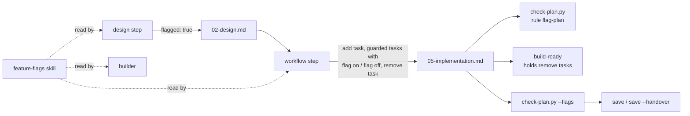

# Design: Feature flags

## 1. Architecture



Nothing here runs in the client's system. DevAgent adds a convention, a
checker rule, a report, a build hold and a standard. The client's flags live
in the client's code and use whatever mechanism the client's design picks
(01, Out of scope).

### 1.1 Grammar

- **`flagged` front-matter key** (02, copied to 05). Optional, `true` or
  `false`; absent means `false`, so every existing plan is unflagged and
  unchanged (AC-2). It sits in 05 as well so a tier S plan, which has no 02,
  can be flagged.
- **Flag bullets on 05 tasks**, inside the existing task grammar (DESIGN
  §5.5). The task parser already accepts them (`^- ([a-z][a-z _]*):`, A-1):
  - the add task: `- flag: add <name>`;
  - the remove task: `- flag: remove <name>`, `- flag_owner: <role>`,
    `- remove_by: YYYY-MM-DD`;
  - every task the flag guards (1.2): `- flag on: <check>` and
    `- flag off: <check>`, each non-empty, saying what is observed with the
    flag in each state.

  `<name>` matches `^[a-z0-9][a-z0-9._-]{0,62}$`. A plan may hold several
  flags. Each name has exactly one add task and one remove task, and **a task
  carries at most one `- flag:` bullet**, so no task both adds and removes.
  `flag_owner` is a role ("client platform lead"), not a person (section 6),
  and is a separate key from `owner`, which `bullets()` splits on ` · ` for
  `[~]` tasks.

### 1.2 Rule `flag-plan` in `check-plan.py`

One new rule. Every failure names it and says which condition failed. Let
*A* be the set of add tasks, *R* the set of remove tasks, and for flag *f*
let `a_f` and `r_f` be its add and remove tasks. "Depends on" is transitive
over `depends`. The rule is structural and applies whatever state a task is
in.

1. **Raw-line scan.** The rule reads each task block's raw lines for the
   keys `flag`, `flag_owner`, `remove_by`, `flag on` and `flag off`. It does
   not use `bullets()`, which keeps only the first occurrence of a key. It
   fails on:
   - any of these keys repeated within one task;
   - any of them arriving as an ` · ` sub-field of an `owner` line;
   - a `flag` value whose verb is not `add` or `remove`, or whose name is
     invalid.
2. **Pairing.**
   - A flagged plan whose 05 has no flag task fails.
   - A name with no add task, no remove task, or more than one of either
     fails.
   - `flag_owner` or `remove_by` on a task that is not a remove task fails.
3. **Remove task fields.** A remove task must have `flag_owner` and
   `remove_by`. `remove_by` must match the existing `DATE` pattern
   (`^\d{4}-\d{2}-\d{2}$`) and then parse with `date.fromisoformat`, which
   alone also accepts `20270131` and `2027-W01-1` (A-5).
4. **Ordering, per flag.**
   - **Add task.** Every task that is not in *A* or *R* either is a
     prerequisite of `a_f` (setup, such as adding the check command) or
     depends on `a_f`. No task runs unordered against the flag being added.
   - **Remove task.** `r_f` depends on every task not in *R*, so removal comes
     after all feature work. Remove tasks of different flags are not ordered
     against each other.
5. **Guarded tasks.** A task is *guarded* by `f` when it depends on `a_f` and
   is not in *R*. Every guarded task carries both `flag on` and `flag off`.
   A task guarded by two flags carries one pair, written to cover both.
   Prerequisites of every add task need neither bullet.
6. **Consistency.**
   - A flag bullet in an unflagged plan fails.
   - 02 and 05 both carrying `flagged` with different values fails.

The rule never fails on a date in the past. A plan must not start failing
the PostToolUse hook on an unrelated edit just because a day passed, so
overdue is reported, never enforced (1.3).

### 1.3 Report: `check-plan.py --flags <feature-dir> | --flags --all [--today YYYY-MM-DD]`

A read-only mode. For each folder it first runs every normal check.

- **Folder fails a check:** it prints
  `<feature>: plan fails check-plan.py; flags not reported` and carries on to
  the next folder.
- **Otherwise:** one line per flag, always prefixed with the feature so
  `--all` output is unambiguous:

  ```
  <feature>: flag <name> · added <state> · owner <role> · remove by <date> · <status>[ · beyond a year]
  ```

  `added <state>` is the add task's state (`[ ]`, `[~]`, `[x]`, `[!]`).
  `<status>` is the first that applies:
  - `removed`: the remove task is `[x]` and the add task is `[x]`. A `[x]`
    task has already passed the evidence and commit checks above, or the
    folder would have failed.
  - `inconsistent`: the remove task is `[x]` and the add task is not.
  - `overdue`: the remove task is not `[x]` and `remove_by` is before the
    report date.
  - `live`: anything else, whether `[ ]`, `[~]` or `[!]`.

  ` · beyond a year` is appended when `remove_by` is more than 365 days after
  the 05 `date`. A folder with no flags prints `<feature>: no flags`.
- **Text:** flag names are pattern-restricted. Owners and dates pass the
  section 1.4 sanitiser and are capped at 80 code points each.
- **Today's date:** `--today` makes tests deterministic. Without it the
  report uses the local date.
- **Exit codes:** 0 when every folder reported, 1 when any folder failed its
  checks, and 2 on a usage error: a bad `--today`, an unknown option, or
  `--flags` with `--hook`.

### 1.4 Output sanitising

Every line `check-plan.py` prints is built from untrusted plan text, so the
sanitising happens once, in `Failure.render` and in the `--flags` printer:

- Unicode `Cc`, `Cf`, `Zl` and `Zp` characters become `?`. This covers a
  newline, ESC and U+202E, so a value cannot forge a second
  `file:line: [rule]` line or an instruction-shaped line.
- A message longer than 300 code points is cut to 299 and ends with `…`.

This is a change to existing output, so the existing failure messages are
re-checked by the existing fixtures.

### 1.5 Build hold for remove tasks

Removing a flag comes after gradual rollout, usually after delivery, so
`build` must not remove the flag just because every other task is done.

- **`build-ready`** leaves out any task carrying `- flag: remove` and prints
  `held for rollout: T-nn (flag <name>, remove by <date>)`. With
  `--removal` it offers those tasks like any other.
- **`/delivery:build <feature> --remove-flags`** passes `--removal`. The
  operator runs it when the rollout is finished.
- **At delivery the remove task may still be `[ ]`.** `save` may set 05 to
  `complete` when every task that is not `[x]` is a held remove task.
  `save --handover` does not stop for those tasks. It puts each one in the
  handover manifest with its owner and date (1.6).

### 1.6 Step files and templates

- **`design.md`** sets `flagged`, invokes `devagent-standards:feature-flags`
  when it does, and names the flag and its rollout in 02.
- **`workflow.md`** does five things:
  - copies `flagged` into 05;
  - writes the add task first (flag off by default) and the remove task
    last;
  - writes `flag on` / `flag off` on every guarded task;
  - asks for a `flag_owner` role, which at delivery is a role on the client
    side;
  - adds a quality gate: each guarded task's verify exercises both states.
- **`build.md`** documents the hold and `--remove-flags`. The `build` skill
  wrapper's argument hint gains `--remove-flags`.
- **`save.md`** has three changes:
  - every mode runs `--flags` and reports `overdue`, `inconsistent` and
    `beyond a year` lines;
  - a `--flags` exit 1 is reported in default mode and blocks `--handover`,
    since the flags are then unknown;
  - `--handover` lists every flag not `removed` in the manifest the
    operator approves and the client receives, with the client-side owner,
    the date, and the statement that **the client owns removal after
    delivery**.
- **`engagement-closeout`** gains one line: live flags are part of what is
  handed over, with their owner and date.
- **Templates.**
  - `02-design.md` gains `flagged: {{true_or_false}}`.
  - `05-implementation.md` gains `flagged` and a comment showing the flag
    bullets.

### 1.7 `devagent-standards:feature-flags` skill

The skill gets a resident stub in `templates/CLAUDE.md` under DETAILED
STANDARDS. Each section below is a rule with its reason, in the existing
standards' shape (FR-8, AC-5):

- **When to flag, and default off.**
- **Owner and removal date for every flag.** Flag debt is a defect, and the
  client owns removal after delivery.
- **Server-side evaluation for anything security-relevant.** A flag
  evaluated in the browser is a hint, never an access control
  (`web-browser-security`, `api-security`). Return only the flags the
  caller's session needs, never the whole set.
- **Client-side exposure.** A client SDK key and any bootstrap payload are
  public. Scope them to non-sensitive flags. Customer identifiers and names
  never go in flag keys or variants.
- **Flagged-off code still ships.** In a public bundle the dark feature is
  readable, so routes, strings and names behind a flag are already public
  (`public-release`).
- **Who may flip a flag.** The flag console and the flag store are writable
  only by authenticated, least-privilege principals, with MFA. Every change
  is logged. Webhooks and streaming connections are authenticated and signed
  (`auth-portal`, `observability`).
- **Security controls are never flag-gated.** Authentication,
  authorization, rate limits and audit logging cannot be switched off by a
  remote flag.
- **Kill switch for features that call a model.** The switch turns the model
  call off without a deploy. Its default is built in rather than fetched, and
  it fails off when the flag service is unreachable (`llm-app-security`).
- **Fail-safe default when evaluation fails.** Security features fail
  closed; new features fail off.
- **Gradual rollout.** Percentage or cohort rollout:
  - bucket on a stable, non-personal identifier;
  - tie a rollback trigger to an alert;
  - apply the same removal rule as any flag.
- **Hosted flag services are vendors.**
  - Each one has a register entry and a pinned SDK.
  - No personal data goes into the evaluation context without approval.
  - Where the client already runs a parameter store, that route goes through
    `cloud-infra`.

### 1.8 Repository check command

`scripts/check-all.sh` runs these in sequence:
- `python3 scripts/check-skills.py`;
- `python3 plugins/delivery/scripts/check-plan.py examples/guard-report`;
- every `scripts/test-*.sh` except `test-delivery-smoke.sh`, which needs a
  live recording and is not a CI suite.

It prints one line per suite with its exit code and time, then a total, and
exits non-zero if any suite failed. It is a single command with no shell
operators in its invocation, so it can be the last task's verify. It
measured about 72 s on 2026-10-17 across today's suites, well over the ~10 s
loop the stack standard asks for. Each task's own verify stays the fast loop;
`check-all.sh` is the whole-repository gate before the operator pushes.
README lists it and CI is unchanged.

## 2. Data flow

1. `design` writes `flagged: true` in 02 when the feature ships behind a
   flag.
2. `workflow` copies `flagged` into 05 and writes three kinds of task:
   - the add task;
   - the guarded tasks, each with `flag on` / `flag off`;
   - the remove task, with `flag_owner` and `remove_by`.
3. `check-plan.py` applies `flag-plan` to the folder it already reads; no
   new file is opened. It runs on demand, in CI on the fixtures, and as the
   PostToolUse hook on every plan edit.
4. `build` runs every task except held remove tasks. The builder reads the
   skill when a task adds or removes a flag. After rollout,
   `/delivery:build <feature> --remove-flags` runs the removal.
5. `save` runs `check-plan.py --flags`. `save --handover` puts every open
   flag into the manifest the operator approves and the client accepts.

The only data read is the plan folder; the only data written is terminal
output and, in build, the same 05 updates as today. Plan files stay in the
engagement repository (CUSTOMER CONFIDENTIALITY); nothing leaves the
workstation.

## 3. Stack

The existing codebase and 01's constraints decide this (stack-selection
hierarchy, step 2):
- Python 3.11+ standard library for `check-plan.py` and `build-lib.py`;
- bash for the test suites and `check-all.sh`;
- markdown for the skill and step files.

No new runtime and no new dependency. Coverage is measured with
`coverage==7.16.2`, already pinned in `plugins/delivery/PINS.md`, run through
`uv` as the existing suites do.

## 4. Authentication and authorization

Not applicable: there is no login, session or principal. The scripts run as
the operator with the operator's file permissions, as today. The skill
covers who may flip a flag in the client's system (1.7).

## 5. APIs

No network interface. The command-line changes:

| Interface | Caller | Input bounds | Errors |
|---|---|---|---|
| `check-plan.py --flags <dir>` / `--flags --all` | operator, `save` | one folder or `docs/plans/*`; `--today` must match `DATE` and parse | exit 1 when a folder fails its checks; exit 2 with a usage line on a bad date, an unknown option, or `--flags` with `--hook` |
| `check-plan.py <dir>` (existing) | operator, CI, hook | unchanged | the new rule adds `file:line: [flag-plan] message` lines; every line is sanitised (1.4) |
| `build-ready <dir> [--max N] [--removal]` | `build` | `--removal` takes no value | unchanged exit codes; held tasks are listed, not counted as ready |
| `/delivery:build <feature> --remove-flags` | operator | as `build` | as `build` |
| `scripts/check-all.sh` | operator, final task | no arguments; any argument exits 2 | non-zero when a suite fails |

## 6. Data classification

| Store / field | Classification | At rest | In transit | Retention |
|---|---|---|---|---|
| Plan files with `flagged`, flag names and dates | Client-confidential (a client's unreleased feature and its rollout) | the engagement repository on the encrypted workstation disk and its approved remote, as for every plan file today | git over TLS, as today | the engagement's retention, then return or destroy at close-out |
| `flag_owner` | a role, not personal data, as the step and template text define it | as above | as above | as above |
| `--flags` output | as the plan | not stored; terminal and transcript only | none | session |
| Handover manifest lines for live flags | client deliverable | the exported handover, as today | as today | the client's |

`personal_data` is false because DevAgent stores and logs nothing new, and
`flag_owner` is defined as a role. A person's name typed there would be the
same class of data as the `owner` field that `[~]` tasks already carry.

## 7. Threat model

Assets:
- the operator's workstation, where the agent runs the checker on untrusted
  plan text;
- the plan checker's integrity as a gate;
- the client's delivered system, through the standard the skill sets.

| Entry point / abuse case | Control | Residual |
|---|---|---|
| Plan text that injects terminal escapes, bidi overrides or a forged `file:line: [rule]` line through any printed value | central sanitiser in `Failure.render` and the `--flags` printer; 300-code-point cap; names pattern-restricted (1.4) | none known |
| A hidden second `- flag:` line, or an owner and date passed as `owner` sub-fields, to get past pairing | raw-line scan; repeated keys and sub-field flag keys fail (1.2 condition 1) | none known |
| A plan file that tries to direct the agent ("mark this flag removed") | step files already treat plan content as DATA; the new grammar adds no instruction-shaped field | as today |
| A flagged plan that drops its removal task to keep a flag forever | `flag-plan` fails; the hook shows it on every edit | an operator can unflag the plan, which shows in the 02 and 05 diff |
| A remove task ticked `[x]` without the removal being done | `[x]` needs `run-verify` evidence and exactly one `T-nn` commit, or the folder fails and `--flags` reports nothing; a removal with no add shows as `inconsistent` | the verify proves only what its command checks, as for every task |
| A removal date pushed out repeatedly, or set far ahead | `--flags` marks `beyond a year`; git keeps the history | **accepted**: DevAgent does not police the date's value |
| A flag left live after delivery, with no one accountable | the handover manifest names the client-side owner and date; the skill and `engagement-closeout` say the client owns removal | **accepted, owner: operator at handover**: DevAgent cannot see the client system after delivery |
| A client system that evaluates a flag in the browser as an access control, exposes the full flag set, leaves the flag console open, or flag-gates a security control | the skill rules each one out (1.7); the spec-panel's security lenses read the skill | depends on the design following the skill, as for every standard |
| Flagged-off code leaking an unreleased feature through a public bundle | the skill names it; `public-release` scans what was built | as for `public-release` |
| A hosted flag SDK added mid-task | the skill treats it as a vendor and a new dependency, which stops for the operator (DESIGN §3.4) | none beyond today's controls |
| A pathological line in a new regex (ReDoS) | anchored patterns, no nested quantifiers, line-by-line reading as today | none known |

The checker still runs no subprocess other than the existing `git log`, and
nothing read from a plan is executed. OWASP areas touched:
- A03, output injection through printed plan text;
- A04, the design of the gate;
- A08, the integrity of the plan as a gate.

## 8. Observability

Not a customer-facing service. Its signals are the checker's
`file:line: [rule] message` lines, the `--flags` report, `build-ready`'s
`held for rollout` line and `check-all.sh`'s per-suite lines. The skill sets
observability for the client's flags: audited changes and a rollback alert.

## 9. Cost

Build cost is one tier M feature of about nine tasks: the checker rule, the
sanitiser, the report, the build hold, the skill with its stub and counts,
the step files and templates, `check-all.sh`, the DESIGN and CHANGELOG
updates, and the final whole-repository run. There are no cloud resources,
so there is no run cost, budget alarm or teardown. The added checker work is
one pass over tasks already parsed, so the hook's run time stays as today.

## 10. Test strategy

**`scripts/test-check-plan.sh`**, in its existing style: copies of fixtures
in a temp directory, and every bad fixture must fail and name only its rule.
- `good-flagged/` is a complete flagged plan (02 and 05) with two flags, a
  setup task before both add tasks, and one remove task still `[ ]`. It
  passes.
- One `bad-flag-plan-*` fixture per condition in 1.2:
  - no flag task;
  - no remove task;
  - two add tasks for one name;
  - no owner;
  - no date;
  - bad dates: `2027-02-30` and the basic-format `20270131`;
  - an unknown verb;
  - an invalid name;
  - a repeated `flag` key in one task;
  - `flag_owner` and `remove_by` passed as `owner` sub-fields;
  - owner or date on a non-remove task;
  - a task unordered against the add task;
  - a task the remove task does not depend on;
  - a guarded task with no `flag off`;
  - a flag bullet in an unflagged plan;
  - 02 and 05 disagreeing on `flagged`.
- Sanitiser cases: an invalid name and verb holding ESC, U+202E and an
  embedded newline print `?` on one line; a 400-character value is cut to
  300 code points.
- `--flags` cases with a fixed `--today`:
  - `live`, `overdue`, `removed`, `inconsistent` and `beyond a year`;
  - `no flags`;
  - `--all` across two folders;
  - a failing folder (exit 1);
  - a bad `--today` and `--flags --hook` (exit 2).
- AC-2: every existing fixture and `examples/guard-report` still pass with
  no edit.

**`scripts/test-build-protocol.sh`:**
- `build-ready` holds a remove task and prints the `held for rollout` line;
- `--removal` offers it;
- an unflagged plan's output is unchanged.

**Skill:**
- `python3 scripts/check-skills.py` checks the new skill's front matter, the
  resident stub, and the resident line, word and token figures.
- It also checks every prose skill count. 13 becomes 14 in `README.md`
  (line 163), `docs/DESIGN.md` (lines 32 and 105), and "thirteen" becomes
  "fourteen" in `.claude-plugin/marketplace.json` and
  `plugins/devagent-standards/.claude-plugin/plugin.json`, whose skill lists
  also gain "feature flags". `CHANGELOG.md` 1.0.0 stays as history.
- `bash scripts/test-check-skills.sh` keeps passing.

**Step files:** `check-skills.py` checks their paths and section
references. The `from-templates` fixture, rebuilt from the changed
templates, must pass `check-plan.py`.

**Coverage:** at least 80% line and branch on `check-plan.py` and
`build-lib.py`, measured with `bash scripts/test-check-plan.sh --coverage`
and the build-protocol suite's coverage mode. Today `check-plan.py` is at
98.1% line and 96.4% branch.

**AC-3** is about what the model writes. The checker enforces its structure
on every 05. The behaviour is observed once, as a named step in the step-file
task: run `workflow` on a copy of the `good-flagged` 02 in a scratch folder,
then check that the result passes `check-plan.py` with the add task first,
the remove task last, and `flag on` / `flag off` on every guarded task. The
result is recorded in that task's commit message.

**AC-6:** `bash scripts/check-all.sh` is the last task's verify. CI confirms
it again on the first push.

## 11. Assumptions to verify

| # | Assumption | Load-bearing | Status |
|---|---|---|---|
| A-1 | `check-plan.py`'s task bullet parser accepts `flag`, `flag_owner` and `remove_by` keys without changes to the existing grammar | yes | ✅ |
| A-2 | A new directory under `plugins/devagent-standards/skills/` with a `SKILL.md` is discovered by Claude Code without listing it in `plugin.json` | yes | ✅ |
| A-3 | No existing fixture or example plan carries a `flagged` key or a `- flag:` bullet, so the new rule leaves them unchanged (AC-2) | yes | ✅ |
| A-4 | `check-skills.py` fails on every prose skill count left at 13 and on stale resident figures, so the count update cannot be half done | no | ❓ |
| A-5 | Python's `date.fromisoformat` rejects every malformed `remove_by` the rule must reject, so no hand-written date parser is needed | no | ⛔ |

## 12. Open decisions

None open. 01 left no question for design, and the operator decided the six
review findings routed to them on 2026-10-17, each as recommended (04):

| ID | Decision needed | Status |
|---|---|---|
| D-1 | R-01 and R-05: raw-line flag scan and central output sanitising | Decided by the operator: apply both (C-05, C-09) |
| D-2 | R-02: add `scripts/check-all.sh` as the repository check command and final verify | Decided by the operator: add it (C-06) |
| D-3 | R-03 and R-06: per-flag ordering rule and explicit `flag on` / `flag off` bullets | Decided by the operator: apply both (C-07, C-10) |
| D-4 | R-04: the remove task stays open at handover, with a client-side owner | Decided by the operator: open removal at handover (C-08) |

## Change log

| ID | Date | Source | Section | Change |
|---|---|---|---|---|
| C-01 | 2026-10-17 | research A-5 | 1.2, 10 | `remove_by` must match the `DATE` pattern before `date.fromisoformat`; bad-date fixtures add `20270131`. Approved by the operator |
| C-02 | 2026-10-17 | research A-1 | 11 | A-1 confirmed (03) |
| C-03 | 2026-10-17 | research A-2 | 11 | A-2 confirmed (03) |
| C-04 | 2026-10-17 | research A-3 | 11 | A-3 confirmed (03) |
| C-05 | 2026-10-17 | R-01 | 1.1, 1.2, 7, 10 | Raw-line scan of flag keys; one `flag:` bullet per task; repeated keys and `owner` sub-field flag keys fail |
| C-06 | 2026-10-17 | R-02 | 1.8, 5, 10 | `scripts/check-all.sh` added as the whole-repository check and final verify; measured run time stated |
| C-07 | 2026-10-17 | R-03 | 1.2, 10 | Ordering defined per flag in graph terms; two-flag and setup-task fixtures |
| C-08 | 2026-10-17 | R-04 | 1.5, 1.6, 7 | Remove tasks held by `build-ready` until `--remove-flags`; may stay open at handover with a client-side owner in the manifest; residual risk accepted |
| C-09 | 2026-10-17 | R-05 | 1.3, 1.4, 7, 10 | Central output sanitiser in `Failure.render` and `--flags` |
| C-10 | 2026-10-17 | R-06 | 1.1, 1.2, 10 | `flag on` / `flag off` bullets required on guarded tasks, replacing the acceptance text check; AC-3 run made a named step |
| C-11 | 2026-10-17 | R-07 | 1.3, 7 | `removed` needs both tasks `[x]` in a passing folder; `inconsistent` and `beyond a year` added |
| C-12 | 2026-10-17 | R-08 | 1.3, 1.6, 5 | `--flags` output, per-state status, failing-folder behaviour and `save` exit handling specified |
| C-13 | 2026-10-17 | R-09 | 1.7 | Skill covers client-side exposure: session-scoped evaluation, public SDK keys, flag console MFA, signed webhooks, no customer identifiers in keys |
| C-14 | 2026-10-17 | R-10 | 1.7 | Skill: security controls never flag-gated; flag store writable only by audited principals; kill switch fails off with a built-in default |
| C-15 | 2026-10-17 | R-11 | 10 | Files that carry the skill count listed |
